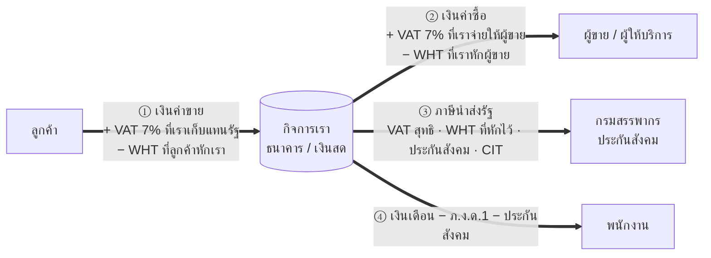
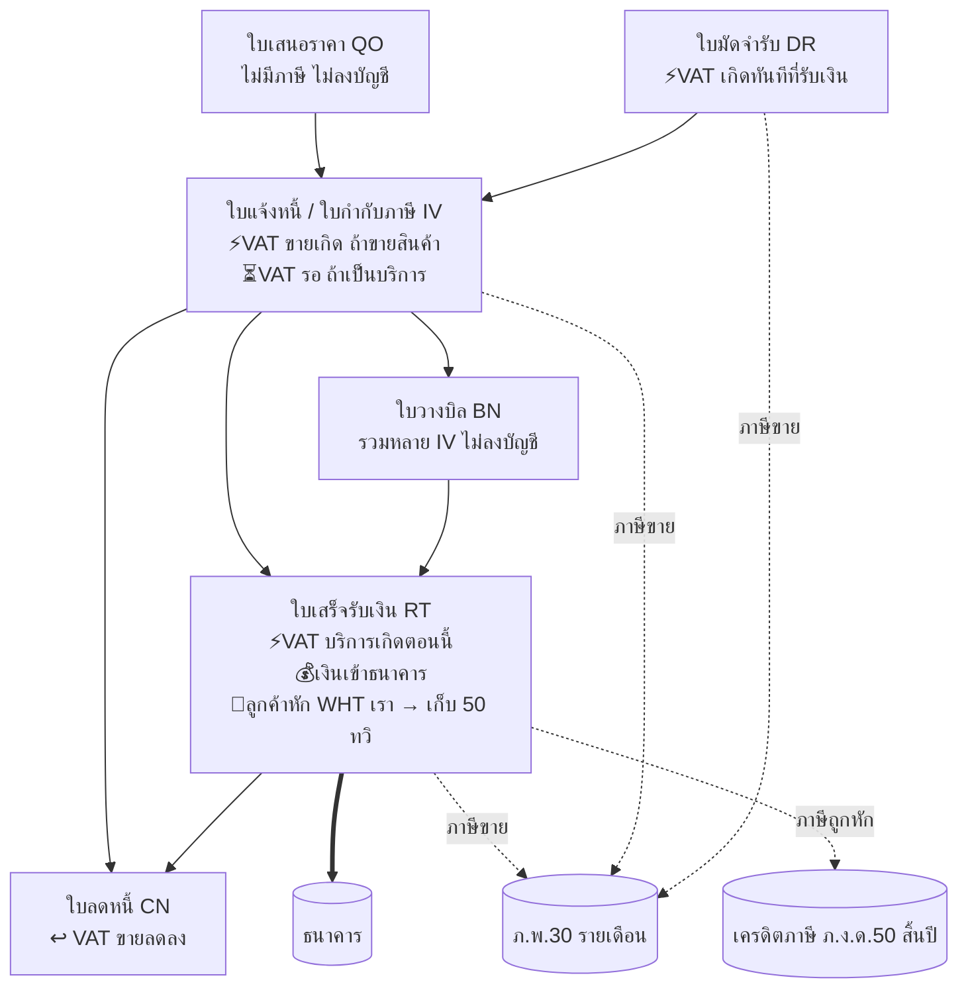
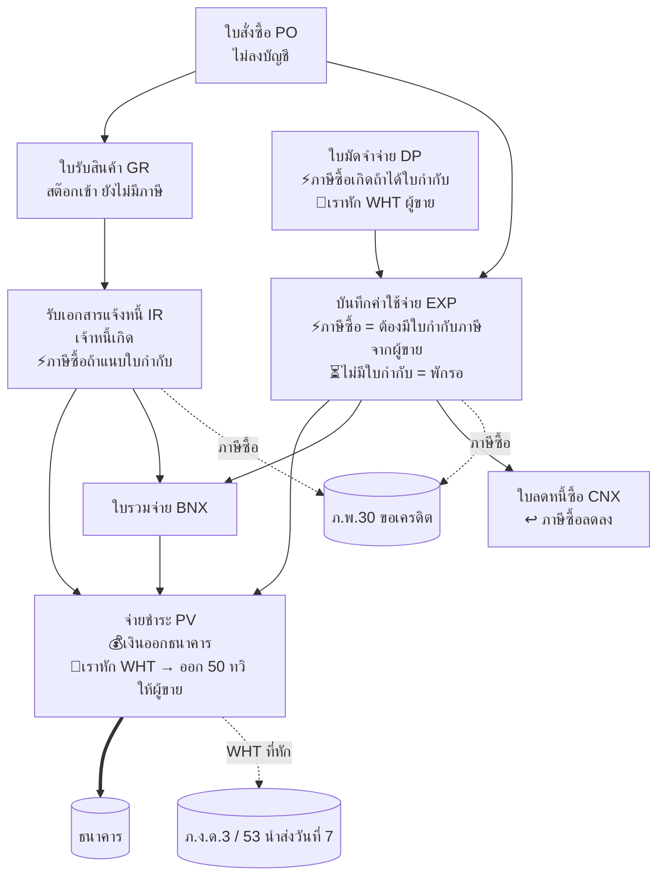

# 00 — โครงพื้นฐาน: เส้นเงินการค้า และจุดที่ภาษีเกาะ

อ่านไฟล์นี้ก่อนไฟล์อื่น — เป็น "แผนที่" ว่าเงินวิ่งจากไหนไปไหน และภาษีแต่ละตัวเกิดขึ้นที่จุดไหนของเส้นเงิน
รายละเอียด Dr/Cr อยู่ใน 04, โครงสร้างข้อมูลอยู่ใน 01

---

## 1. เส้นเงินหลัก 3 เส้น



**หลักคิด**: เงินที่เข้า-ออกกิจการมี 2 ชั้นเสมอ
- **ชั้นการค้า** = มูลค่าสินค้า/บริการจริง (เป็นรายได้/ค่าใช้จ่ายของเรา)
- **ชั้นภาษี** = เงินที่เรา "ถือแทน" หรือ "ถูกถือแทน" ไม่ใช่ของเรา (VAT, WHT) → ต้องแยกบัญชีและนำส่ง/ขอคืนให้ครบ

---

## 2. เส้นขาย (เงินเข้า) — เอกสาร → เงิน → ภาษี



| ขั้น | เงินจริง | ภาษีที่เกิด | ไปไหน |
|---|---|---|---|
| ใบเสนอราคา | ยังไม่มี | ไม่มี | — |
| มัดจำรับ | ลูกค้าโอนมัดจำ | **VAT ขาย 7% ทันที** (จุดความรับผิด = รับเงิน) | 215101 → ภ.พ.30 เดือนนั้น |
| ใบแจ้งหนี้ ขายสินค้า | ยังไม่มี (ลูกหนี้) | **VAT ขายเกิดทันที** (ส่งมอบ/ออกใบกำกับ) | 215101 → ภ.พ.30 เดือนที่ออก |
| ใบแจ้งหนี้ บริการ | ยังไม่มี | VAT **ยังไม่เกิด** พักไว้ | 215102 รอเรียกเก็บ |
| ใบเสร็จ | เงินเข้า | บริการ: VAT เกิดตอนนี้ → ย้าย 215102 → 215101 | ภ.พ.30 เดือนที่รับเงิน |
| ใบเสร็จ + ลูกค้าหัก ณ ที่จ่าย | เงินเข้า **น้อยกว่า**ยอดบิล | WHT ที่ถูกหัก = สินทรัพย์ของเรา | 115403 → เครดิตตอนยื่น ภ.ง.ด.50 |
| ใบลดหนี้ | คืนเงิน หรือ ลดลูกหนี้ | VAT ขาย **ลดลง** | ภ.พ.30 เดือนที่ออก CN |

**ตัวอย่างตัวเลข** ขายบริการ 10,000 บาท ลูกค้าเป็นนิติบุคคล
```
มูลค่าบริการ            10,000.00   → รายได้ 410201
VAT 7%                  +  700.00   → ภาษีขาย 215101 (เราเก็บแทนรัฐ)
ยอดบิล (net)            10,700.00
ลูกค้าหัก WHT 3%        −  300.00   → 115403 ภาษีถูกหัก (3% ของ 10,000 ไม่ใช่ของ 10,700)
เงินเข้าธนาคารจริง      10,400.00   → [Bank]
```
สิ่งที่ระบบต้องทำให้ตรง: `paymentAmount = netAmount − WHT` ไม่งั้น PEAK ตอบ "Should be paid full amount"

---

## 3. เส้นซื้อ (เงินออก) — เอกสาร → เงิน → ภาษี



| ขั้น | เงินจริง | ภาษีที่เกิด | ไปไหน |
|---|---|---|---|
| ใบสั่งซื้อ | ยังไม่มี | ไม่มี | — |
| มัดจำจ่าย | เราโอนมัดจำ | ภาษีซื้อ (ถ้าได้ใบกำกับ) + **เราหัก WHT** | 115401 / 215203-204 |
| ใบรับสินค้า | ยังไม่มี | ไม่มี (สต๊อก + เจ้าหนี้รอบิล) | — |
| รับบิล / ค่าใช้จ่าย **มีใบกำกับภาษี** | ยังไม่จ่าย (เจ้าหนี้) | **ภาษีซื้อ 7%** = สินทรัพย์ (ขอเครดิตคืนได้) | 115401 → ภ.พ.30 เดือนที่เลือกยื่น (ภายใน 6 เดือน) |
| รับบิล **ไม่มีใบกำกับ** | เจ้าหนี้ | ภาษีซื้อ **พักรอ** จนได้ใบกำกับ | 115402 → ย้ายไป 115401 เมื่อได้ |
| ภาษีซื้อต้องห้าม (รับรอง, รถเก๋ง) | — | ขอคืน**ไม่ได้** → เป็นค่าใช้จ่าย | 540201 |
| จ่ายชำระ | เงินออก **น้อยกว่า**ยอดบิล | **เราหัก WHT** = หนี้สินที่ต้องนำส่งรัฐ | 215203 (บุคคล ภ.ง.ด.3) / 215204 (นิติบุคคล ภ.ง.ด.53) → ยื่นภายในวันที่ 7 |
| ใบลดหนี้ซื้อ | ได้เงินคืน หรือ ลดเจ้าหนี้ | ภาษีซื้อ **ลดลง** | ภ.พ.30 |

**ตัวอย่างตัวเลข** จ้างบริษัทรับเหมาทำงาน 10,000 บาท มีใบกำกับภาษี
```
มูลค่างาน               10,000.00   → ค่าใช้จ่าย 5xxxxx
ภาษีซื้อ 7%             +  700.00   → 115401 (เราจ่ายให้ผู้ขาย แล้วไปหักกับภาษีขายของเรา)
ยอดบิล (net)            10,700.00
เราหัก WHT 3%           −  300.00   → 215204 ภ.ง.ด.53 ค้างจ่าย (ต้องนำส่งรัฐ + ออก 50 ทวิ ให้เขา)
เงินออกธนาคารจริง       10,400.00   → [Bank]
```

---

## 4. เส้นภาษี — เงินที่ "ไม่ใช่ของเรา" ไหลไปรัฐอย่างไร

```mermaid
flowchart LR
    subgraph VAT[ภาษีมูลค่าเพิ่ม — ทุกเดือน]
        OUT[ภาษีขาย 215101<br/>เก็บจากลูกค้า] --> NET{ขาย − ซื้อ}
        IN[ภาษีซื้อ 115401<br/>จ่ายให้ผู้ขาย] --> NET
        NET -->|ขาย > ซื้อ| PAYVAT[นำส่ง ภ.พ.30<br/>215351 → ธนาคาร<br/>ภายใน 15 (ออนไลน์ 23)]
        NET -->|ซื้อ > ขาย| CREDIT[เครดิตยกไปเดือนหน้า 115451<br/>หรือขอคืน 115452]
    end
    subgraph WHT[หัก ณ ที่จ่าย — ทุกเดือน]
        W1[เราหักผู้ขาย<br/>215203 ภ.ง.ด.3 บุคคล<br/>215204 ภ.ง.ด.53 นิติบุคคล] -->|ภายในวันที่ 7 (ออนไลน์ 15)| RD1[นำส่งสรรพากร]
        W2[เราหักพนักงาน<br/>215201 ภ.ง.ด.1] -->|ภายในวันที่ 7| RD1
        W3[ลูกค้าหักเรา<br/>115403 สินทรัพย์] -->|เก็บ 50 ทวิ ไว้| CIT
    end
    subgraph SSO[ประกันสังคม — ทุกเดือน]
        S1[215501 ลูกจ้าง 5% + นายจ้าง 5%<br/>เพดาน 750/ฝ่าย] -->|ภายในวันที่ 15| SSOF[สำนักงานประกันสังคม]
    end
    subgraph CITX[ภาษีเงินได้นิติบุคคล — ครึ่งปี + สิ้นปี]
        H[ภ.ง.ด.51 ครึ่งปี<br/>115404 จ่ายล่วงหน้า<br/>ภายใน 2 เดือนหลังครึ่งปี] --> CIT[ภ.ง.ด.50 สิ้นปี<br/>กำไรทางภาษี × อัตรา<br/>− 115404 − 115403<br/>ภายใน 150 วันหลังปิดปี]
        CIT --> RD2[นำส่ง / ขอคืน]
    end
```

### ตารางภาษีครบชุดที่ระบบต้องรองรับ

| ภาษี | เกิดจากเส้นเงินไหน | เราเป็น | บัญชีถือพัก | แบบยื่น | กำหนด | เอกสารที่ต้องออก/เก็บ |
|---|---|---|---|---|---|---|
| **VAT ขาย** | ขาย (เงินเข้า) | ผู้เก็บแทนรัฐ | 215101 / 215102 รอ | ภ.พ.30 | 15 เดือนถัดไป | ใบกำกับภาษี + รายงานภาษีขาย |
| **VAT ซื้อ** | ซื้อ (เงินออก) | ผู้มีสิทธิ์เครดิต | 115401 / 115402 รอ / 540201 ต้องห้าม | ภ.พ.30 | 15 (เลือกเดือนได้ภายใน 6 เดือน) | ใบกำกับภาษีจากผู้ขาย + รายงานภาษีซื้อ |
| **ภ.พ.36** | ซื้อบริการจากต่างประเทศ (SaaS, Ads) | ผู้นำส่งแทนผู้ขายต่างชาติ | 215103 | ภ.พ.36 | 7 เดือนถัดไป | นำส่งแล้วใช้เป็นภาษีซื้อเดือนถัดไป |
| **WHT เราหัก (บุคคล)** | จ่ายค่าบริการ/เช่า/จ้าง ให้บุคคลธรรมดา | ผู้หัก | 215203 | ภ.ง.ด.3 | 7 เดือนถัดไป | 50 ทวิ ให้ผู้รับเงิน |
| **WHT เราหัก (นิติบุคคล)** | จ่ายให้บริษัท/หจก. | ผู้หัก | 215204 | ภ.ง.ด.53 | 7 เดือนถัดไป | 50 ทวิ |
| **WHT เงินเดือน** | จ่ายเงินเดือน | ผู้หัก | 215201 | ภ.ง.ด.1 (+1ก สรุปปี) | 7 เดือนถัดไป | 50 ทวิ สิ้นปี |
| **WHT จ่ายต่างประเทศ** | จ่ายค่าสิทธิ/บริการ ต่างชาติ | ผู้หัก | 215205 | ภ.ง.ด.54 | 7 เดือนถัดไป | |
| **WHT ถูกหัก** | ลูกค้าจ่ายเรา | ผู้ถูกหัก | 115403 (สินทรัพย์) | ใช้เครดิตใน ภ.ง.ด.50 | สิ้นปี | เก็บ 50 ทวิ ที่ได้รับ |
| **ประกันสังคม** | เงินเดือน | นายจ้าง | 215501 | สปส.1-10 | 15 เดือนถัดไป | |
| **CIT ครึ่งปี** | กำไรประมาณการ | ผู้เสีย | 115404 (จ่ายล่วงหน้า) | ภ.ง.ด.51 | 31 ส.ค. (ปีปฏิทิน) | |
| **CIT สิ้นปี** | กำไรทางภาษี | ผู้เสีย | 590000 / 215301 | ภ.ง.ด.50 | 150 วันหลังปิดงบ | งบการเงินตรวจสอบแล้ว |
| **ภาษีธุรกิจเฉพาะ** | ดอกเบี้ยเงินกู้กรรมการ | ผู้เสีย | 215401 | ภ.ธ.40 | 15 เดือนถัดไป | |
| **ภาษีที่ดิน/ป้าย** | ทรัพย์สิน | ผู้เสีย | 530506 / 530508 | ท้องถิ่น | เม.ย. / มี.ค. | |

---

## 5. ปฏิทินเงินออกเพื่อภาษี (ทุกเดือน) — สิ่งที่ Dashboard ต้องเตือน

```
วันที่  7   ภ.ง.ด.1 / 3 / 53 / 54 + ภ.พ.36   (ออนไลน์ +8 วัน → 15)
วันที่ 15   ภ.พ.30 + ภ.ธ.40 + ประกันสังคม     (ออนไลน์ ภ.พ.30 → 23)
ครึ่งปี     ภ.ง.ด.51 ภายใน 2 เดือนหลังสิ้นครึ่งปี
สิ้นปี      ภ.ง.ด.50 + งบการเงิน (DBD) ภายใน 150 วัน ; ภ.ง.ด.1ก ภายใน ก.พ.
```

---

## 6. จุดเชื่อมที่พลาดบ่อย (ระบบต้องบังคับ)

1. **WHT คิดจากฐานก่อน VAT** (10,000 ไม่ใช่ 10,700) — คำนวณผิดทั้งรายงานและเงินโอน
2. **VAT บริการ vs สินค้า** จุดความรับผิดต่างกัน — บริการรอจนรับเงิน; ถ้าออกใบกำกับก่อนรับเงินถือว่าเกิดทันที
3. **ภาษีซื้อไม่มีใบกำกับ = ขอคืนไม่ได้** ต้องพักไว้ 115402 แล้วตามใบกำกับ ไม่ใช่ลง 115401 ไปก่อน
4. **เลขใบกำกับภาษีซื้อซ้ำต่อ vendor** → ขอคืนซ้ำ = โทษปรับ ระบบต้อง block ตอน Approve
5. **มัดจำ** VAT เกิดทันทีตอนรับมัดจำ ไม่ใช่ตอนส่งมอบ; ตอนออก IV จริงให้คิด VAT เฉพาะส่วนที่เหลือ
6. **ใบลดหนี้** ต้องอ้างใบกำกับต้นทางและมีเหตุผลตามกฎหมาย (reasonType) ไม่งั้นลด VAT ขายไม่ได้
7. **50 ทวิ ต้องออกทันทีที่จ่าย** ไม่ใช่สิ้นเดือน; ข้อมูลครบ: ผู้หัก/ผู้ถูกหัก, เลขผู้เสียภาษี, สาขา, ประเภทเงินได้, อัตรา, ฐาน, ภาษี
8. **ภาษีถูกหักที่ลูกค้าหักเรา** ถ้าไม่เก็บ 50 ทวิ จากลูกค้า = เครดิตสิ้นปีหาย → ระบบต้องมีสถานะ "รอรับ 50 ทวิ" ต่อ receipt
9. **เช็ค** เงินยังไม่เข้าจริงจนกว่าจะขึ้นเงิน แต่ VAT บริการเกิดเมื่อ "ได้รับเช็ค" (ถือเป็นรับชำระ) — แยกบัญชี 113102/111401
10. **ปิดงวดแล้วห้ามแก้** — ทุก journal/ใบกำกับที่ตกในเดือนที่ยื่น ภ.พ.30 แล้ว ต้อง lock; แก้ = ยื่นเพิ่มเติม

---

## 7. สรุปเป็นสมการเดียว

```
เงินเข้าธนาคารจริง  = ยอดขายก่อน VAT + VAT ขาย − WHT ที่ลูกค้าหักเรา
เงินออกธนาคารจริง   = ยอดซื้อก่อน VAT + VAT ซื้อ − WHT ที่เราหักผู้ขาย
เงินที่ต้องส่งรัฐ     = (VAT ขาย − VAT ซื้อที่ขอคืนได้) + WHT ที่เราหักไว้ทั้งหมด + ประกันสังคม + CIT
กำไรทางบัญชี         = ยอดขายก่อน VAT − ยอดซื้อ/ค่าใช้จ่ายก่อน VAT (VAT และ WHT ไม่เกี่ยว)
```
ถ้าตัวเลข 4 บรรทัดนี้กระทบยอดกันได้ทุกเดือน = ระบบบัญชีถูกต้อง
