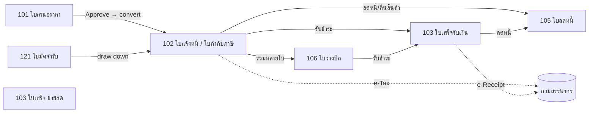
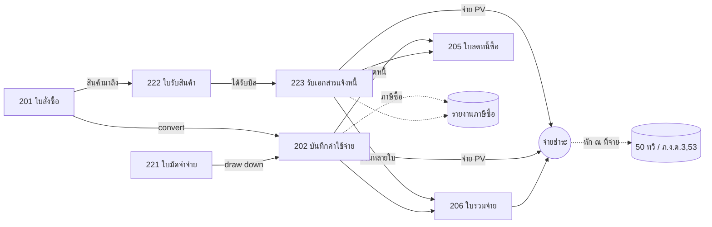
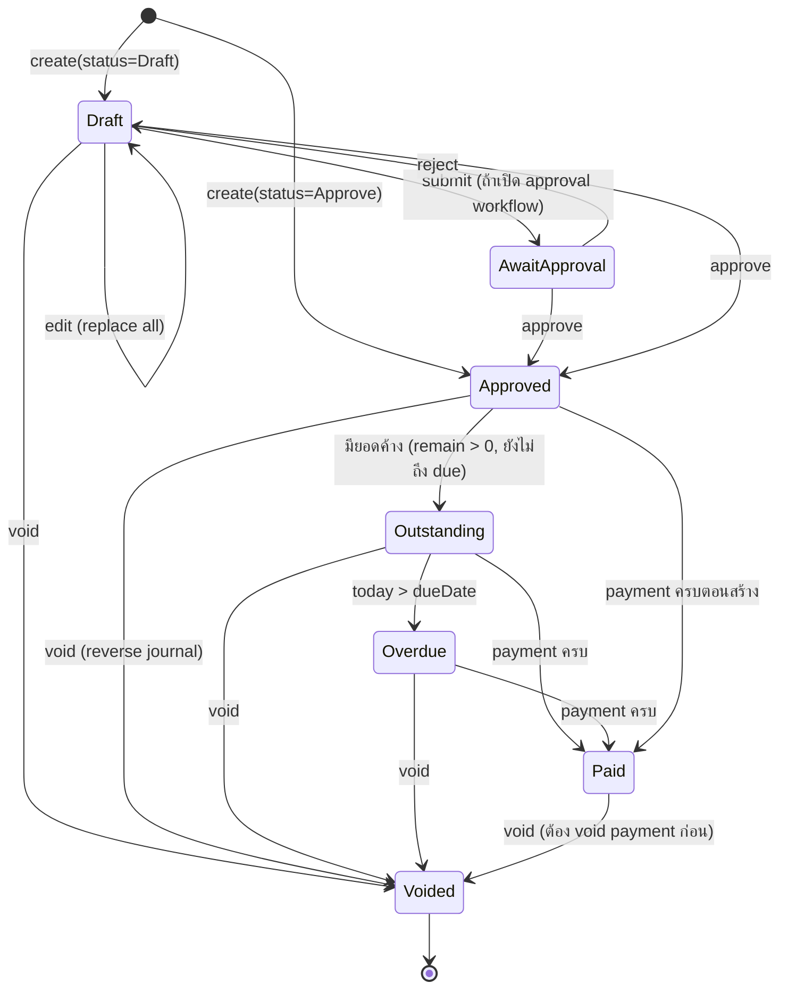

# 03 — Document Flows & State Machines

## 1. วงจรขาย (Order-to-Cash)

กฎอ้างอิง (reference integrity):
- IV ← QO: QO ต้อง Approve; QO void ไม่ได้ถ้ามี IV
- RT ← IV: IV ต้อง Approve, `remainAmount > 0`; RT.amount ≤ IV.remainAmount
- BN ← IV[]: ทุก IV Approve; BN ไม่ลงบัญชีเอง
- CN ← IV/RT: `transactionType` 102/103 + `transactionId`; CN.net ≤ ต้นทาง.net
- DR → IV: IV ระบุ DR ที่ใช้; DR.remainAmount ลดลง; DR void ไม่ได้ถ้าถูก draw down

## 2. วงจรซื้อ (Procure-to-Pay)

กฎอ้างอิง:
- EXP ← PO: PO void ไม่ได้ถ้ามี EXP
- IR ← GR: GR status → 5 IssuedInvoiceReceipt; GR void ไม่ได้
- ใบกำกับภาษีซื้อ (receivedTaxInvoice) ผูกกับ EXP / IR / DP อย่างใดอย่างหนึ่ง; เลขซ้ำต่อ vendor ห้าม (เช็คตอน Approve)
- EXP ใช้ `accountCode` เสมอ (ไม่ใช้ productCode) — PEAK design; ระบบเราอาจอนุญาต productCode สำหรับซื้อสต๊อก ⚠️

## 3. State machine ของเอกสาร

### 3.1 เอกสารทั่วไป (QO, IV, RT, PO, EXP, CN, CNX, BN, BNX, DR, DP)

หมายเหตุ: Approved แล้ว **edit ไม่ได้** — ต้อง void + สร้างใหม่ (เลขใหม่)

### 3.2 Goods Receipt
`Draft → AwaitApproval → Approved → IssuedInvoiceReceipt` ; void ได้ทุกสถานะยกเว้น IssuedInvoiceReceipt (ต้อง void IR ก่อน) ; API สร้างได้แค่ Draft/AwaitApproval

### 3.3 Invoice Receipt
`Draft → AwaitApproval → Approved → Outstanding → Overdue → Paid → GotReceipt` ; GotReceipt = ได้รับใบเสร็จจาก vendor แล้ว

### 3.4 Deposit (DR/DP)
`Draft → AwaitApproval → WaitingPayment → Paid → AlreadyIssued (ถูก draw down หมด)` + Overdue, Voided

### 3.5 Journal
`Active ↔ Voided` (ไม่มี draft; void ถาวร; เลข reuse ได้)

## 4. ลำดับการทำงานที่ client (AI agent / UI) ต้องทำก่อนสร้างเอกสาร
1. `SearchContacts` ด้วย Tax ID ก่อน ชื่อทีหลัง → ไม่พบ → แสดง preview `CreateContact` ให้ยืนยัน
2. ถ้า org ใช้ product code: `ListProduct`/`ListService` ต่อบรรทัด → ไม่พบ → fallback `accountCode` + ติดธง ⚠️
3. ถ้าเป็น Expense: `GetSuggestionAccountCodeExpense(contact)` → ว่าง → `GetAccountCodes`
4. ถ้ามีการชำระ: `GetPaymentMethod` หา code
5. คำนวณ VAT/WHT ตาม 04 §1 → แสดง preview → user ยืนยัน → `Create*` (Draft หรือ Approve)
6. หลังสร้าง: `InsertTag` / `CreateTransactionClassification` ตามต้องการ
7. อ่านกลับด้วย `Get*` เพื่อแสดง `documentLink`

## 5. Business profile (การตั้งค่าระดับองค์กร)
การตั้งค่าระดับองค์กรที่ระบบเราต้องมีเป็นตาราง `organization_settings`:
- `is_vat_registered`
- `use_product_code` (ขายด้วย catalog หรือ account โดยตรง)
- account mapping ยอดนิยม (ค่าเช่า → 530201, ฯลฯ)
- payment methods ที่ใช้บ่อย (code + name + bank)
- default contacts (RD, SSO, DBD, Payroll)
- document numbering prefix ต่อประเภท
- approval workflow เปิด/ปิด
- fiscal year start
