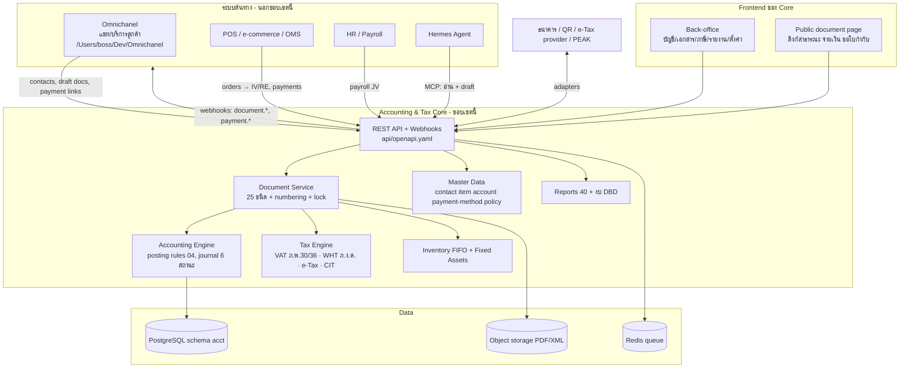

# 06 — System Architecture: Accounting & Tax Core (Frontend · Backend · API · Database)

เป้าหมาย: **Accounting & Tax Core** ต้นแบบจากโปรแกรม PEAK (บัญชี + เอกสาร + ภาษี) เป็นบริการแยกต่างหาก ระบบอื่น (Omnichanel ที่มีอยู่แล้ว, POS, e-commerce, Hermes) เป็น *ผู้ใช้* ของมันผ่าน API/Webhook เท่านั้น — ขอบเขตและสัญญาดู **12** (แก้ 9 พ.ย. 2569: ตัด Omni Channel/Hermes ออกจากขอบเขตนี้ตามคำสั่ง)

## 1. ภาพรวม



## 2. Layering ภายใน ERP Core (Modular Monolith → แยกได้ภายหลัง)

```
apps/
  api/            REST (OpenAPI = api/openapi.yaml) + webhook dispatcher
  worker/         queue consumers: journal posting, PDF render, channel send, nightly reconcile
  web/            back-office ของ core (Next.js/React) — ไม่มีหน้าแชท
packages/
  domain/         entities + value objects + state machines (ไม่พึ่ง framework)
  accounting/     posting templates (04 §2), amount calc (04 §1), period lock, TB/GL queries
  tax/            VAT engine, WHT engine, ภ.พ.30 / ภ.ง.ด.3/53 / 50 ทวิ generators
  documents/      per-type services (create/edit/approve/void), numbering, reference integrity
  integrations/   adapters ที่ core เป็นเจ้าของ: bank feed, QR payment callback, e-Tax provider, PEAK import, webhook dispatcher
  db/             schema.sql + migrations + repositories
  sdk/            TypeScript client generated from OpenAPI (ใช้โดย web, Omnichanel, Hermes MCP, tests)
```

**กฎการพึ่งพา**: `web → sdk → api → documents → accounting/tax → domain → db` ; ระบบภายนอกทุกตัว (Omnichanel, POS, Hermes) พึ่ง `sdk`/API เท่านั้น ห้ามแตะ schema `acct` โดยตรง (กฎเดียวกับ Astra: plugins never touch the ERP DB)

## 3. Stack ที่เสนอ (boring, พิสูจน์แล้ว)

| Layer | เลือก | เหตุผล |
|---|---|---|
| DB | PostgreSQL 16 | numeric แม่นยำ, generated columns, row-level security ต่อ org, pg_trgm ค้นชื่อไทย |
| Queue/Cache | Redis 7 (BullMQ) | rate limit ต่อ user (PEAK 10/min), outbox → webhook, ส่งข้อความช่องทาง |
| Backend | TypeScript · Node 22 · Fastify · Drizzle ORM · Zod | type ตรงกับ OpenAPI ทั้งสองทาง; SDK เดียวกันให้ระบบภายนอกใช้ |
| Frontend | Next.js 15 · React · TanStack Query · shadcn/ui | หน้าเอกสารเป็นฟอร์มซับซ้อน ต้องการ table/virtualization |
| PDF | Playwright/Chromium render จาก HTML template | ใบกำกับภาษีภาษาไทย + ฟอนต์ Sarabun |
| Auth | OIDC (Keycloak/Auth.js) + RBAC ต่อ org | ไม่มีสิทธิ์ → HTTP 403 |
| MCP (optional) | MCP server ของ core ที่ wrap `sdk/` scope อ่าน + Draft | ใครจะต่อ AI ก็ใช้ได้ แต่ core ไม่ขึ้นกับ AI ตัวใด |
| Infra | Docker Compose (dev) → Railway/Fly (prod) | |

## 4. ขอบเขตกับระบบภายนอก
Omni Channel, Hermes, POS, e-commerce **ไม่อยู่ในบริการนี้** Omnichanel มีอยู่แล้วที่ `/Users/boss/Dev/Omnichanel` (Hono + Postgres schema `omni`, webhooks, MCP 27 tools) และดูแลงานบริการลูกค้าทั้งหมด
Core รับเฉพาะ "เหตุการณ์ทางธุรกิจที่มีผลทางบัญชี/ภาษี" ผ่าน API และส่งผลกลับด้วย webhook — สัญญาเต็มใน **12-accounting-core-boundary.md**

## 5. Back-office Web App (เทียบหน้า PEAK)

| โมดูล | หน้า | หมายเหตุ |
|---|---|---|
| Dashboard | ยอดขาย/ซื้อ/กระแสเงินสด/AR-AP aging/ภาษีค้างยื่น | |
| ขาย | QO · IV · RT · BN · CN · DR | list (filter status/date/contact) + form + preview PDF + timeline |
| ซื้อ | PO · GR · IR · EXP · BNX · CNX · DP | EXP form มีช่อง "ลงทะเบียนภาษีซื้อ" |
| การเงิน | ช่องทางการเงิน, รับ/จ่ายชำระ, เช็ค, reconcile ธนาคาร, โอนระหว่างบัญชี | |
| บัญชี | ผังบัญชี, สมุดรายวัน 5 เล่ม, GL, TB, ปิดงวด/ล็อกงวด, ยอดยกมา | |
| ภาษี | รายงานภาษีซื้อ/ขาย, ภ.พ.30, ภ.ง.ด.3/53/1, 50 ทวิ, ไฟล์ยื่นออนไลน์ | |
| รายงาน | P&L, BS, Cash flow, aging, ยอดขายต่อสินค้า/ลูกค้า | |
| สินค้า | สินค้า/บริการ, หน่วยนับ, (phase 2: stock card) | |
| ผู้ติดต่อ | ลูกค้า/ผู้ขาย, ประวัติเอกสาร, เครดิตเทอม | |
| ตั้งค่า | องค์กร, VAT registration, เลขที่เอกสาร 24 ชุด, ผู้ใช้/สิทธิ์, นโยบายบัญชี (10 §3.5), API keys/webhooks, ผู้ให้บริการ (ธนาคาร/e-Tax) | |

## 6. ลำดับการสร้าง "ทีละโปรแกรม" (Delivery plan)

| # | โปรแกรม | ขอบเขต | Done เมื่อ |
|---|---|---|---|
| 1 | **Core + Master data** | schema, auth, org, contact, account (seed 264), payment-method, item, numbering | API + หน้า CRUD ใช้ได้, seed ผัง PEAK |
| 2 | **Accounting Engine** | journal, posting templates, period lock, TB, GL | manual journal + TB สมดุล + GL ตรง |
| 3 | **Sales documents** | QO → IV → RT, CN, BN, DR + payment + PDF ใบกำกับภาษี | ออกใบกำกับภาษีจริงได้, journal อัตโนมัติถูกต้องตาม 04 |
| 4 | **Purchase documents** | PO → GR → IR / EXP, CNX, BNX, DP, ภาษีซื้อ, WHT + 50 ทวิ | ภาษีซื้อขึ้นรายงาน, 50 ทวิพิมพ์ได้ |
| 5 | **Tax filing** | รายงานภาษีซื้อ/ขาย, ภ.พ.30, ภ.ง.ด.3/53, ไฟล์ยื่น | ตัวเลขตรง TB |
| 6 | **Financial statements** | P&L, BS, Cash flow, aging, ปิดปี | |
| 7 | **Integration surface** | api_client/scopes, webhook self-service (HMAC, retry, replay), SDK, MCP server ของ core (อ่าน + draft) | ระบบภายนอกสร้าง draft + รับ webhook ได้ตาม 12 |
| 8 | **Inventory + Fixed assets** | FIFO, คลัง, ใบเบิก/โอน/ปรับต้นทุน, ทะเบียนสินทรัพย์, ค่าเสื่อม | Σ stock = 114102, ค่าเสื่อม JV อัตโนมัติ |
| 9 | **Bank/QR/e-Tax adapters + PEAK import** | bank feed, payment callback, e-Tax XML, นำเข้าจาก PEAK | กระทบยอดอัตโนมัติ, ใบกำกับ e-Tax ส่งได้ |
| 10 | Multi-currency, public document page, Smart Insight | phase 2 | |

ทุกโปรแกรมส่งมอบพร้อม: migration, API + OpenAPI, หน้า UI, test (unit กฎบัญชี + integration), seed data

## 7. Non-functional
- Multi-tenant: `organization_id` ทุกตาราง + RLS; tenant = 1 บริษัท
- Audit: ทุก write เก็บ `created_by/updated_by` + outbox event; เอกสาร Approve แล้ว immutable
- เงิน: `numeric(18,2)` THB; ห้าม float; ปัดที่ระดับเอกสาร
- เวลา: เก็บ UTC, แสดง Asia/Bangkok; ปีงบประมาณตั้งได้
- Rate limit: ต่อ user ต่อ endpoint group (ตั้งค่าได้)
- Backup: PITR รายวัน; เอกสารภาษีเก็บ ≥ 5 ปี (ป.รัษฎากร ม.87/3)
- i18n: ไทยเป็นหลัก อังกฤษรอง (ผังบัญชีมี nameEn อยู่แล้ว)
