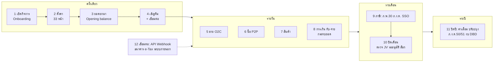
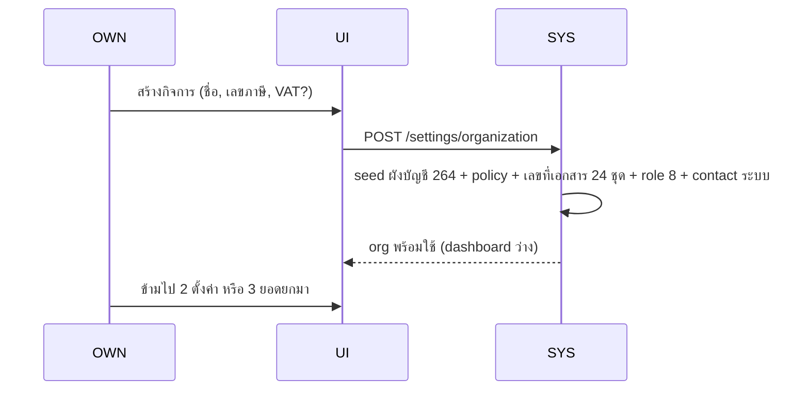
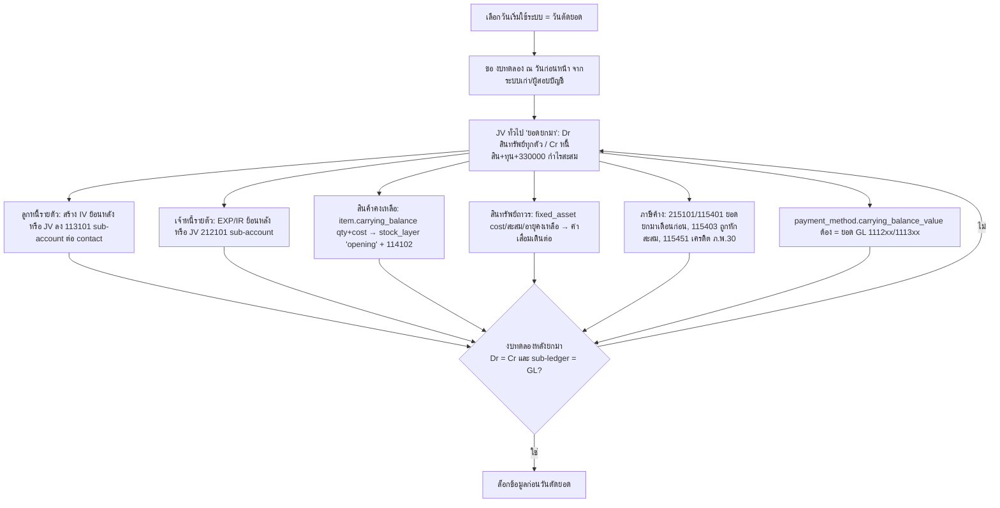
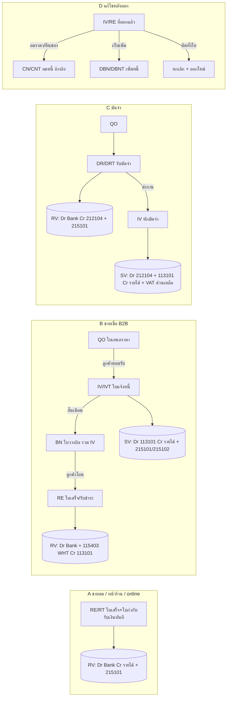
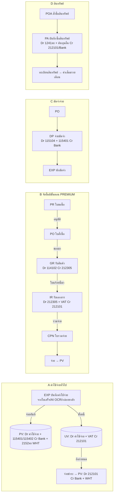
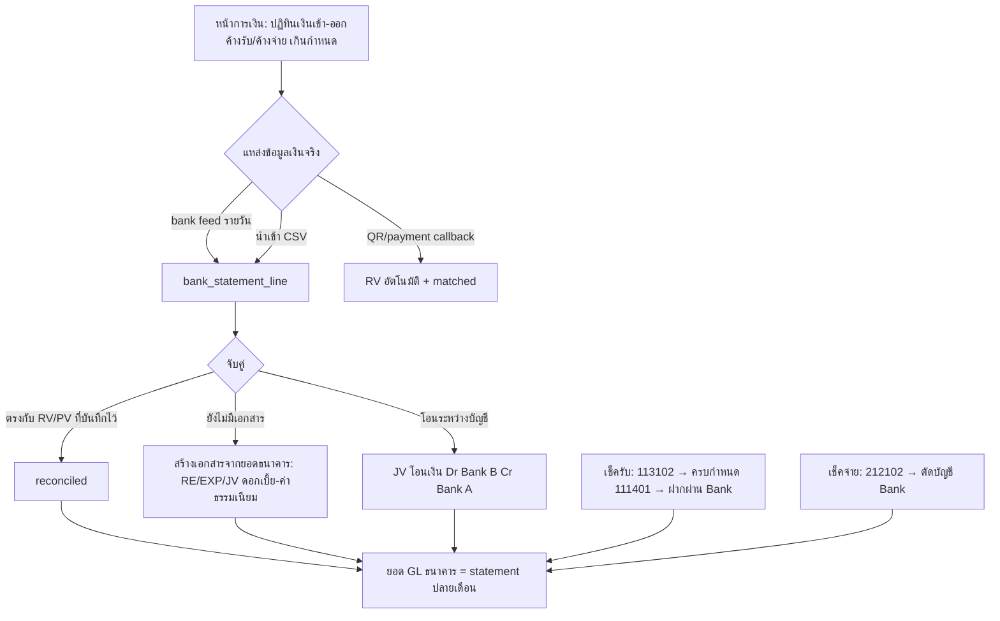
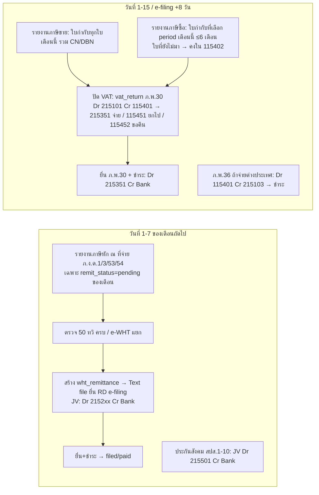
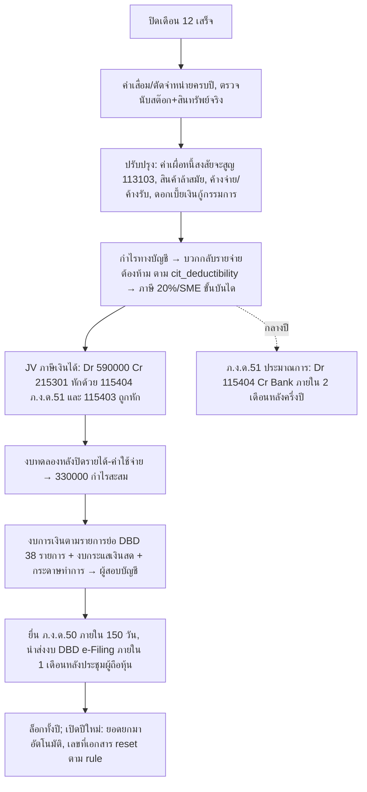

# 11 — Flow การทำงานทั้งระบบ (Operating Workflows)

ต่างจาก 03 (state machine รายเอกสาร) และ 00 (เส้นเงิน/ภาษี): ไฟล์นี้คือ **ลำดับงานจริงของคน** ตั้งแต่เปิดกิจการ → งานรายวัน → ปิดเดือน → ปิดปี → เลิกใช้ พร้อมระบุ **ใครทำ (role) · ทำที่หน้าไหน (screen) · เกิดเอกสาร/JV อะไร · ระบบบังคับอะไร · API/Webhook/Agent เข้ามาตรงไหน**
ที่มา: หน้าเว็บ PEAK v2.199.0 (10), journal จริง (09), enum และความสามารถ (08); ❗ = จุดที่ PEAK ไม่บังคับแต่ระบบเราต้องบังคับ

Role ย่อ: **OWN** เจ้าของ/ผู้ดูแลระบบ · **ACC** บัญชี · **SALE** ขาย · **PUR** จัดซื้อ/ธุรการ · **FIN** การเงิน · **EXT** คู่ค้า/ลูกค้า · **SYS** ระบบอัตโนมัติ · **AGENT** ระบบภายนอก/API key (สร้าง Draft เท่านั้น)

---

## 0. แผนที่รวม (ชั้นเวลา)

---

## 1. เปิดกิจการ (Onboarding) — OWN

| ขั้น | ทำอะไร | หน้า PEAK | ระบบทำให้ | บังคับ |
|---|---|---|---|---|
| 1.1 | สมัคร/ล็อกอิน (อีเมล, ThaID) | หน้าเลือกกิจการ | สร้าง `app_user`; 1 user หลายกิจการ | ยืนยันอีเมลก่อนใช้ฟีเจอร์ผู้ใช้/สิทธิ์/e-Tax/ปุ่มชำระเงิน |
| 1.2 | สร้างกิจการ: ชื่อ, เลข 13 หลัก, สาขา, รูปแบบกิจการ, **จด VAT? + วันที่** | ตั้งค่า › ข้อมูลกิจการ | `organization` + `seed_chart_of_accounts()` 264 บัญชี + `org_accounting_policy` default + `document_number_rule` 24 ชุด + `org_role` 8 + contact ระบบ (RD/SSO/DBD/EWF/Payroll) + หน่วย PU0001.. | เลข 13 หลักต้องผ่าน check-digit; ไม่จด VAT → ห้ามออกใบกำกับ/คิด VAT (PEAK คืน "Merchant is not registered for VAT") |
| 1.3 | โลโก้/ตราประทับ/ลายเซ็น, ยืนยันตัวตนกิจการ (KYC) | โลโก้และตราประทับ, โปรไฟล์ | แสดงบนเอกสาร/ลิงก์สาธารณะตาม policy | — |
| 1.4 | เลือกแพ็กเกจ/ทดลอง | ข้อมูลแพ็กเกจ | ของเรา: เปิดทุกฟีเจอร์ (ไม่ล็อกตามแพ็กเกจ) | — |

## 2. ตั้งค่าก่อนออกเอกสารใบแรก — OWN + ACC

ลำดับที่ถูกต้อง (PEAK ไม่บังคับลำดับ แต่ถ้าสลับจะย้อนแก้ยาก):

| ลำดับ | หน้า | ตัดสินใจอะไร | กระทบ | เจ้าของ |
|---|---|---|---|---|
| 2.1 | **เลขที่เอกสาร** | prefix/ปี/เดือน/วัน/running ต่อ 24 ชนิด, แยกชุดใบกำกับ, reuse เลข void | เลขใบกำกับภาษีเปลี่ยนภายหลังไม่ได้ (ม.86/4) ❗ล็อก rule หลังออกใบกำกับใบแรก | ACC |
| 2.2 | **ใบกำกับภาษี** | default DR/IV/RE ออกใบกำกับหรือไม่, ภ.พ.30 policy | tax point + รายงานภาษีขาย | ACC |
| 2.3 | **ประเภทราคา** | แยก/รวม VAT default | คำนวณราคา | ACC |
| 2.4 | **บันทึกบัญชีรายรับ/รายจ่าย** | GL ของ CN/DBN ไม่อ้างอิง, IR/GR clearing | Dr/Cr อัตโนมัติ | ACC |
| 2.5 | **เมนูสินค้า/คลัง** | perpetual/periodic, COGS ตอนขาย, SKU, คลัง default | สต๊อก/ต้นทุน; เปลี่ยนหลังมีสต๊อกไม่ได้ ❗ | ACC |
| 2.6 | **ผู้ติดต่อ** (วงเงิน/prefix), **การสร้างชื่อซ้ำ**, **วันที่ครบกำหนด**, **หมายเหตุเอกสาร** | นโยบายขายเชื่อ, template ข้อความ | เตือน/ห้ามออกเอกสารเกินวงเงิน | OWN |
| 2.7 | **ช่องทางการเงิน** | เงินสด/ธนาคาร/e-Wallet/สำรองรับจ่าย + GL (1111xx/1112xx/1113xx) | ทุกการรับ-จ่ายต้องเลือกช่องทาง | FIN |
| 2.8 | **ผังบัญชี** | เพิ่มบัญชีย่อย (ธนาคารแต่ละบัญชี, ค่าใช้จ่ายเฉพาะกิจการ) ภายใต้ 38 รายการย่องบ DBD | งบการเงิน | ACC |
| 2.9 | **กลุ่มจัดประเภท** (สาขา/โครงการ/แผนก) + แท็ก | มิติวิเคราะห์ (PEAK Board) | รายงานแยกมิติ | OWN |
| 2.10 | **สิทธิ์ผู้ใช้งาน** → เชิญผู้ใช้ | 8 role หรือ custom (permission string) | ใครอนุมัติ/ใครร่าง | OWN |
| 2.11 | **บัญชีรายวัน** (PREMIUM) | JV จากเอกสาร = อนุมัติทันที หรือรออนุมัติ | งบนับเฉพาะ approved ❗ | ACC |
| 2.12 | **การแสดงข้อมูลสาธารณะ / ช่องทางรับชำระบนเอกสาร / ลิงก์ขอใบกำกับ / รายงานอีเมล / Smart Insight** | ประสบการณ์ลูกค้า + เตือน | — | OWN |

## 3. ยอดยกมา (Opening balance) — ACC

❗ ระบบเราบังคับ: `payment_method.carrying_balance` = GL, Σ ลูกหนี้ราย contact = 113101, Σ stock_layer = 114102 ก่อนอนุญาตให้ล็อก

## 4. เชิญทีม + เชื่อมต่อ — OWN

| ขั้น | ทำอะไร | ผล |
|---|---|---|
| 4.1 | เชิญผู้ใช้ (อีเมล + role) | `org_member` (invited → accepted); PEAK Support ได้เมื่อขอ |
| 4.2 | ลงทะเบียนสำนักงานบัญชี (ถ้าใช้) | ACC ภายนอกเข้าถึงด้วย role บัญชี |
| 4.3 | เชื่อม e-Tax provider (INET/Leceipt/Google) | `policy.etax_provider`; ใบกำกับภาษี → XML+PDF ลงลายเซ็น |
| 4.4 | เชื่อมช่องทางรับเงิน QR (SCB/BBL/Krungsri/ChillPay/Beam/Payso) ด้วย Biller ID | ปุ่มชำระ + QR บนเอกสาร; callback → RV อัตโนมัติ |
| 4.5 | เชื่อม bank feed (Krungsri Statement API / นำเข้า CSV) | `bank_statement_line` รายวัน → กระทบยอด |
| 4.6 | เชื่อม e-commerce/OMS (Shopee, Lazada, TikTok, LINE SHOPPING, ZORT…) | `external_order` → IV/RE อัตโนมัติ (idempotent) |
| 4.7 | เชื่อมเครือข่ายคู่ค้า / LINE OA | เอกสารคู่ค้าเข้า `file_vault` (กล่องขาเข้า) |
| 4.8 | สร้าง API key ให้ระบบภายนอก (scope อ่าน + Draft) | `api_client` + scope; ดู §12 และ 12 |

---

## 5. ขาย (Order-to-Cash) — SALE → ACC → FIN

### 5.1 ทางเดินหลัก 4 แบบ

### 5.2 ขั้นตอนรายละเอียด ขายเชื่อ (B)
| ขั้น | role | หน้า/การกระทำ | ระบบ | บังคับ/เตือน |
|---|---|---|---|---|
| 1 | SALE | สร้าง QO (ลูกค้า, รายการ, วันที่ใช้ได้ถึง) → อนุมัติ → ส่งอีเมล/ลิงก์ | QO `await_accept`; ไม่ลงบัญชี | วงเงินขายเชื่อ: warn/block ตาม policy; QO พ้นกำหนด → `expired` |
| 2 | EXT | เปิดลิงก์สาธารณะ กด "ยอมรับ" (หรือ SALE กดแทน) | QO `accepted` | — |
| 3 | SALE | "ออกเอกสารต่อ" → IV (ทั้งใบหรือบางส่วนตาม policy QO) เลือก ออกใบกำกับ? คลัง? | IV draft → อนุมัติ → **SV**; สินค้า: ตัดสต๊อก FIFO + Dr 510101 Cr 114102; ใบกำกับ: เลขชุด IVT, VAT → 215101; บริการไม่ออกใบกำกับ → 215102 | IV วันที่ < ล็อก → ปฏิเสธ; QO ออกครบ → `fully_issued` |
| 4 | SYS | Webhook `invoice.created`; Smart Insight นับวันครบกำหนด; e-Tax ส่ง XML ถ้าเปิด | `document_history` | — |
| 5 | SALE/ACC | สิ้นเดือน: สร้าง BN รวม IV ค้างของลูกค้า → ส่ง | BN; ไม่ลงบัญชี | void IV ที่อยู่ใน BN ไม่ได้ ต้อง void BN ก่อน |
| 6 | FIN | เงินเข้า (โอน/QR/เช็ค) → รับชำระที่ BN หรือ IV: วันที่, ช่องทาง, จำนวน, **ถูกหัก ณ ที่จ่าย** | **RV** ต่องวด (`payment_group_id`): Dr Bank + 115403 Cr 113101; บริการ+ใบกำกับตอนรับเงิน → RT + Dr 215102 Cr 215101 | จำนวน+WHT ≠ ยอด → `WHT_PAYMENT_MISMATCH`; เกินยอด → `OVERPAYMENT`; ชำระครบ → `paid` |
| 7 | FIN | ได้รับ 50 ทวิ จากลูกค้า → ติ๊ก "ได้รับหนังสือรับรอง" | `wht_received.received_certificate` | สิ้นปี 115403 ต้อง = Σ ใบรับรอง |
| 8 | FIN | กระทบยอด: จับคู่ `bank_statement_line` กับ RV | reconciled | ดู §8 |

### 5.3 ขายจากระบบภายนอก (POS / e-commerce / ระบบอื่น) — SYS
ระบบภายนอกส่งข้อเท็จจริงการขายเข้า `POST /documents/receipts|invoices` เป็น **Draft** พร้อม `Idempotency-Key` → core คำนวณ VAT/WHT/บัญชีเอง → คนในฝ่ายบัญชีอนุมัติ (หรือกฎ auto-approve ที่ OWN เปิด) → webhook `document.approved` กลับไปพร้อมเลขที่และลิงก์ PDF; ระบบภายนอกไม่ส่งยอดภาษีหรือรหัสบัญชีมาเอง (ดู 12 §2)

## 6. ซื้อ (Procure-to-Pay) — PUR → ACC → FIN

### 6.1 ทางเดินหลัก

### 6.2 ขั้นตอนรายละเอียด ค่าใช้จ่าย (A) — เส้นที่ใช้บ่อยสุด
| ขั้น | role | การกระทำ | ระบบ | บังคับ/เตือน |
|---|---|---|---|---|
| 1 | PUR/ทุกคน | ถ่ายใบเสร็จส่ง LINE OA / อัปโหลดคลังเอกสาร / คู่ค้าส่งผ่านเครือข่ายคู่ค้า | `file_vault` (ยังไม่ออกเอกสาร) + AI OCR → suggestedExpense | — |
| 2 | ACC | เปิดไฟล์ → "สร้างค่าใช้จ่าย": ผู้ขาย (ค้นหา DBD), **เลขที่ใบกำกับภาษี**, วันที่, บรรทัด (บัญชี 5xxxxx / สินค้า, VAT, **WHT ต่อบรรทัด**) | EXP draft; เลือก "ยังไม่ชำระ (ตั้งหนี้)" หรือใส่ชำระเลย | ภาษีซื้อต้องห้าม (รับรอง/รถยนต์นั่ง) → แนะนำ 540201; ใบกำกับซ้ำต่อผู้ขาย → `DUPLICATE_TAX_INVOICE` |
| 3 | ACC (role approve) | อนุมัติ | **UV** หรือ **PV** (จ่ายทันที = ใบเดียว ไม่ผ่านเจ้าหนี้); VAT → **115402 ก่อนเสมอ** แล้ว **JVTX** ย้ายเข้า 115401 ตาม period ที่เลือกยื่น; WHT → 215203 (บุคคล) / 215204 (นิติบุคคล) | วันที่ < ล็อก → ปฏิเสธ; ผู้ขายบุคคล + ค่าจ้าง → เตือน ภ.ง.ด.3 ไม่ใช่ 1 (PEAK ลง 215201 ❗) |
| 4 | SYS | ออก **50 ทวิ** (ถ้าไม่ใช่ e-WHT) ส่งผู้ขาย; สถานะนำส่ง pending | `wht_certificate` | — |
| 5 | FIN | ถึงกำหนด: จ่ายจาก BN/CPN หรือ EXP รายใบ (โอน/เช็ค/QR) | PV ต่องวด; เช็คจ่าย → 212102 จนตัดบัญชี | เกินยอด/ WHT ไม่ตรง → ปฏิเสธ |
| 6 | ACC | ใบกำกับภาษีมาทีหลัง → "รับใบกำกับภาษี" ที่รายการ ภาษีซื้อ › รอรับ | JVTX: Dr 115401 Cr 115402 ใน period ที่เลือก (≤ 6 เดือน) | เกิน 6 เดือน → ขอคืนไม่ได้ → 540201 |

### 6.3 สำรองรับจ่าย (พนักงานจ่ายแทน)
พนักงานจ่าย → EXP เลือกช่องทาง `expense_claim` ของพนักงาน (= เจ้าหนี้พนักงาน) → สิ้นงวด FIN โอนคืน: Dr expense_claim Cr Bank; ยอด expense_claim ค้างแสดงในหน้าการเงิน

## 7. สินค้า (Inventory, perpetual + FIFO) — PUR/คลัง → ACC

| เหตุการณ์ | เอกสาร | สต๊อก | บัญชี |
|---|---|---|---|
| ซื้อเข้า | EXP (บันทึกซื้อสินค้า) / GR | + `stock_layer` ต้นทุน = ราคาซื้อ (+ปรับต้นทุนภายหลัง) | Dr 114102 |
| ขาย | IV/RE | − FIFO (คลังที่เลือก) | Dr 510101 Cr 114102 (ถ้า calc_cogs_on_sale) |
| คืนจากลูกค้า | CN goods_return | + ชั้นใหม่ต้นทุนเดิม | Dr 114102 Cr 510101 |
| เบิกใช้ภายใน/ตัวอย่าง/เสีย | PRR ใบเบิก (สาเหตุ) | − FIFO | Dr บัญชีที่เลือก (5xxxxx) Cr 114102 |
| ส่งคืนของเบิก | ใบส่งคืนเบิก | + | กลับด้าน |
| ย้ายคลัง | ใบโอนย้าย | − คลังต้น + คลังปลาย ต้นทุนเดิม | ไม่ลง |
| ค่าขนส่ง/นำเข้า | ใบปรับต้นทุน อ้างอิง EXP | ปันเข้าชั้นที่ยังเหลือ (มูลค่า/จำนวน) | Dr 114102 Cr ค่าใช้จ่ายเดิม |
| ตรวจนับ | JV + stock_movement `count_adjustment` | ± | Dr/Cr 114102 กับ 5xxxxx สินค้าขาด/เกิน |

ปิดเดือน: Σ `v_stock_balance.value` ต้อง = 114102 ❗ (รายงาน "การซื้อขายสินค้า/บริการ")

## 8. การเงินรายวัน — FIN

สำรองรับจ่าย, เงินสดย่อย: นับเงินสดจริง = 111101 ทุกวัน/สัปดาห์

---

## 9. ภาษีรายเดือน — ACC (ปฏิทินดู 00 §5)

❗ ระบบบังคับ: ปิด VAT เดือนแล้วห้ามเพิ่ม/แก้ใบกำกับในเดือนนั้น (ต้องใช้ CN/DBN หรือยื่นเพิ่มเติม); ยอด Text file ภ.ง.ด. ต้อง = ยอด JV นำส่ง

## 10. ปิดเดือน — ACC → OWN

| ลำดับ | งาน | หน้า/รายงาน | เกณฑ์ผ่าน |
|---|---|---|---|
| 1 | เคลียร์ร่าง/รออนุมัติทุกเอกสาร | list ทุกชนิด แท็บ ร่าง/รออนุมัติ | = 0 หรือมีเหตุผล |
| 2 | ตรวจ JV รออนุมัติ / **ควรพิจารณา** (AI flag: บัญชีผิดหมวด, ยอดผิดปกติ, คู่ค้าซ้ำ) | บัญชีรายวัน | approved ทั้งหมด |
| 3 | กระทบยอดธนาคารทุกช่องทาง + เงินสด + สำรองรับจ่าย | การเงิน | GL = statement |
| 4 | Sub-ledger = GL: ลูกหนี้ (อายุลูกหนี้), เจ้าหนี้ (อายุเจ้าหนี้), สต๊อก, มัดจำ 212104/115104, 212305 clearing ต้องมี GR คู่ IR | รายงานอายุหนี้, สินค้า, แยกประเภท | ผลต่าง = 0 |
| 5 | ภาษี §9 เสร็จ; 115403 = ใบรับรองที่ได้รับ; 115402 เหลือเฉพาะใบที่ยังไม่มา | รายงานภาษี | — |
| 6 | รายการประจำ: ค่าเสื่อม (auto), ค่าใช้จ่ายค้างจ่าย/จ่ายล่วงหน้าตัดจ่าย, เงินเดือน (จาก Payroll/HR), ดอกเบี้ย | JV ทั่วไป / recurring | — |
| 7 | งบทดลองก่อนปิด → งบกำไรขาดทุน/งบฐานะ เทียบเดือนก่อน (เปรียบเทียบ 6 เดือน) | บัญชี | ผู้บริหารรับทราบ |
| 8 | **ล็อกข้อมูล** ถึงสิ้นเดือน | ตั้งค่า › ล็อกข้อมูล | หลังล็อก แก้ได้เฉพาะ JV ปรับปรุงเดือนถัดไป |
| 9 | รายงานทางอีเมลสรุปเดือนถึง OWN/สำนักงานบัญชี | รายงานทางอีเมล | — |

## 11. ปิดปี — ACC + ผู้สอบบัญชี + OWN

---

## 12. การเชื่อมต่อ (API / Webhook / Marketplace / Agent) — OWN + Dev

### 12.1 ของ PEAK
PEAK เปิด Open API และ Webhook ผ่านการสมัครกับทีม PEAK ระบบเราทำเป็น self-service แทน ตาม 12.2

### 12.2 ของเรา (self-service)
| ขั้น | ใคร | หน้า | ผล |
|---|---|---|---|
| 1 | OWN | ตั้งค่า › API & Integrations › สร้าง key (api_key / oauth_client / **mcp**) เลือก scope = permission string | plaintext แสดงครั้งเดียว; `api_client` |
| 2 | Dev/AGENT | เรียก API ด้วย Bearer; rate limit ต่อ key; เครดิตรายเดือน (optional) | `api_usage_log` → หน้า "การใช้งาน API" |
| 3 | OWN | เพิ่ม webhook endpoint: URL, secret (HMAC-SHA256), event types, env | ยิงทุก event + `X-Event-Id`; retry 5 ครั้ง; replay ได้ |
| 4 | OWN | Marketplace: เลือก provider → OAuth / กรอก Biller ID / อัปโหลด statement | `integration_connection`; sync log |
| 5 | SYS | ขาเข้า: `/integrations/inbound/payment/{provider}` รับ callback ชำระ | เอกสาร/การชำระอัตโนมัติ + history actor_kind=api |

### 12.3 ระบบภายนอกใน flow
Omnichannel (บริการลูกค้า), POS, e-commerce, HR, AI agent เป็น "ผู้เรียก" แบบเดียวกันทั้งหมด: สิทธิ์ default = อ่าน + สร้าง Draft; ไม่มีสิทธิ์อนุมัติ, void, จ่ายเงิน, แก้ policy, ล็อกงวด — รายละเอียดใน 12

---|---|---|
| แชทลูกค้า | ตอบราคา/สต๊อก (อ่าน item, v_stock_balance), สร้าง QO/RE **draft**, ส่งลิงก์ชำระ | view.product, view.contact, create.quotation, create.receipt (draft) |
| ใบเสร็จเข้ามา | อ่าน OCR, เสนอ EXP draft พร้อมบัญชี/WHT ที่แนะนำ | create.expense (draft) |
| ปิดเดือน | ตรวจ JV "ควรพิจารณา" อธิบายเหตุผล, สรุป aging, ร่างอีเมลทวงหนี้ | view.* |
| ห้าม | อนุมัติ, void, จ่ายเงิน, แก้ policy, ล็อกงวด | ไม่ให้ approve.*, delete.*, payment.*, manage.settings |

---

## 13. ตาราง role × งาน (ใครทำอะไรได้)

| งาน | OWN | ACC | SALE | PUR | FIN | AGENT |
|---|---|---|---|---|---|---|
| ตั้งค่า 33 หน้า / policy / เลขที่เอกสาร | ✅ | เฉพาะบัญชี-ภาษี | — | — | — | — |
| สร้าง QO/IV/RE draft | ✅ | ✅ | ✅ | — | — | ✅ draft |
| อนุมัติเอกสารขาย | ✅ | ✅ | ✅ (ถ้า role) | — | — | ❌ |
| สร้าง/อนุมัติ EXP/PO/PA | ✅ | ✅ | — | ✅ สร้าง | — | draft |
| รับ-จ่ายเงิน, กระทบยอด, เช็ค | ✅ | ✅ | — | — | ✅ | ❌ |
| JV ทั่วไป, ปิด VAT, นำส่ง WHT, ค่าเสื่อม | ✅ | ✅ | — | — | — | ❌ |
| ล็อกงวด, void หลังอนุมัติ | ✅ | ✅ (ก่อนล็อก) | — | — | — | ❌ |
| ดูงบ/รายงาน | ✅ | ✅ | รายงานขาย | รายงานซื้อ | การเงิน | ✅ อ่าน |
| สร้าง API key / webhook / เชื่อม marketplace | ✅ | — | — | — | — | ❌ |

PEAK role ที่ตรงกัน: ผู้ดูแลระบบ=OWN · ผู้ดูแลบัญชีการเงิน/บัญชีการเงิน=ACC · จัดการเอกสารฝั่งรายรับ/จัดการใบเสนอราคา=SALE · ร่างเอกสารทั้งหมด=AGENT-like (ร่างได้ อนุมัติไม่ได้)

## 14. จุดที่ระบบเราบังคับเพิ่มจาก PEAK (สรุป ❗)
1. ล็อก `document_number_rule` ของชุดใบกำกับภาษีหลังออกใบแรก; ไม่ reuse เลข void สำหรับใบกำกับ
2. ยอดยกมาต้องผ่านเช็ค sub-ledger = GL ก่อนล็อก
3. IR ที่ไม่มี GR คู่ภายใน X วัน → เตือน (212305 ค้าง)
4. บุคคลธรรมดา + ค่าบริการ → ภ.ง.ด.3 ไม่ใช่ 1
5. ปิด VAT เดือนแล้ว → ห้ามแก้ใบกำกับเดือนนั้น
6. Agent/API key สร้างได้แค่ Draft เว้นแต่ OWN เปิดกฎอัตโนมัติ
7. งบนับเฉพาะ JV approved; JV รออนุมัติค้างข้ามเดือน → บล็อกการล็อกงวด
8. Σ stock_layer = 114102, Σ fixed_asset = 1241xx, Σ wht_received = 115403 ตรวจอัตโนมัติทุกคืน
